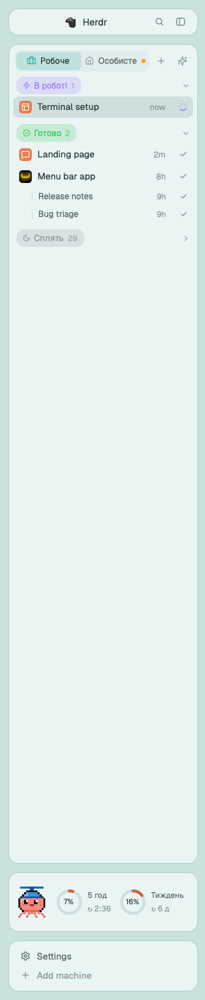

# herdr-propeller

A sidebar for running many Claude Code sessions in [Herdr](https://herdr.dev), the terminal
workspace app. Built as Herdr mods and config, not a fork, so Herdr's updates keep coming.

- **Groups by attention.** Spaces sorted into «Чекає на тебе» (needs you), «Нове» (unread),
  «В роботі» (working), «Готово» (done) and «Сплять» (asleep), newest first. Right-click a group
  pill to pick the working indicator: Herdr's circle, dots, pulse, braille, moon, bars.
- **Two profiles, like Dia's.** «Робоче» (work) and «Особисте» (personal): a space is personal
  when its folder is under one of your personal folders, or when you move it there (right-click
  a space, or drag it onto the profile). Swipe sideways with two fingers to flip between them.
- **Sleep.** A space without activity for a day goes to «Сплять»: its idle Claudes quit to free
  memory, and open again with `claude --resume` when you come back. Drag a space in or out by hand.
- **Claude comes back after a reboot.** Each tab that had a Claude conversation resumes it.
- **Icons for spaces.** ✨ asks Claude to pick one per space: the app's own icon from its code,
  else a brand logo (Simple Icons), else a Lucide icon.
- **The octopus card.** Claude's 5-hour and weekly limits as rings, with time to reset.
  Right-click it to free RAM (quit idle Claudes outside the open space).
- **Context menu.** Herdr's own, plus: move to the other profile, sleep or wake, another Claude
  in this space, a Claude on its own branch (`claude -w`).
- **Claude Code skill `herdr-tabs`.** Ask Claude to open a tab or space for a task, and it
  starts another Claude there with a brief, then watches it (`hc wait`) and brings back the result.
- **Glass layout** in light and dark, following the system.

The interface is in Ukrainian.

## Install

1. `brew install --cask herdr-app`, then open Herdr once from Spotlight.
2. `git clone https://github.com/Propeller-Crew/herdr-propeller.git ~/code/herdr-propeller && ~/code/herdr-propeller/install.sh`
3. Your folders: copy `config.example.json` to `~/.config/herdr-propeller.json` and edit it.
   `workFolder` and the first of `personalFolders` are where + makes a new space; `ownProducts`
   (optional) tells the icon picker about your own apps and where their code is.
4. Limits on the card: the Claude Code status line has to save them. In your statusLine script
   (it gets the status JSON on stdin) add:
   `limits=$(echo "$input" | jq -c '.rate_limits // empty'); [ -n "$limits" ] && printf '%s' "$limits" > "$HOME/.claude/rate-limits.json"`

Updates: the octopus card checks GitHub every few hours and shows a badge when there is a new
version; right-click it → «Оновити herdr-propeller». By hand: `git -C ~/code/herdr-propeller pull && ~/code/herdr-propeller/install.sh`.

Don't start Herdr (or `hc`) from inside a Claude Code session: the core inherits
`CLAUDE_CODE_CHILD_SESSION` and Claude in it stops saving conversations. Start it from Spotlight.

## What's here

- `mods/propeller/`: resume, sleep, icons, the octopus card. State in `~/.config/herdr-app/data/propeller-state.json`.
- `mods/propeller-agents/`: the sidebar.
- `patches/`: our changes to other mods, applied on every sync: Herdr's context menu
  (`propeller-menu`), space-folders and Islands' tab bar.
- `sync-mods.sh`: builds the patched mods from `~/code/herdr-ext` and links everything into the app.
  `install.sh` clones those upstreams at the commits our patches fit, then runs it.
- `layout-propeller.json`: the layout; `make-glass.py` derives the glass one from it.
- `themes/`, `keys.json` (alt-up/down through the list), `art/` (icons), `octopus/` (the card's frames).
- `import-cmux.py`: moves workspaces and Claude conversations over from cmux.
- `config.toml`, `limits.py`: for the terminal version of herdr (TUI), unused by the app.

## Credits

- [Herdr](https://herdr.dev).
- [Islands](https://github.com/CodeyPacker/herdr-mods) by CodeyPacker (MIT), the card layout and tab bar.
- [herdr-space-folders](https://github.com/jankeesvw/herdr-space-folders) by jankeesvw (MIT).
- [herdr-sim](https://github.com/wobsoriano/herdr-sim) by wobsoriano (MIT).
- Icons: [Lucide](https://lucide.dev) (ISC, `art/LICENSE`), [Simple Icons](https://simpleicons.org) fetched on demand.
- The pixel octopus comes from our cmux sidebar.

MIT, see `LICENSE`.
